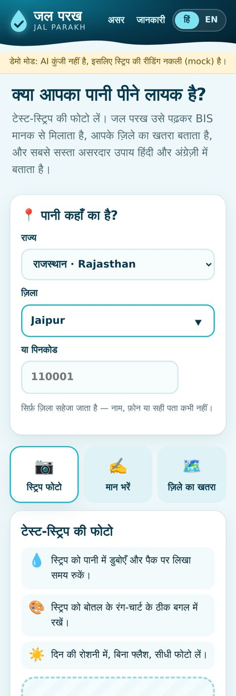
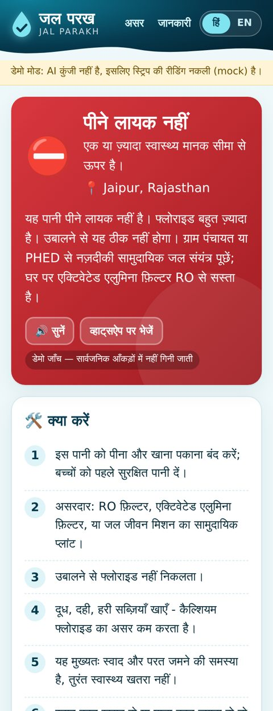
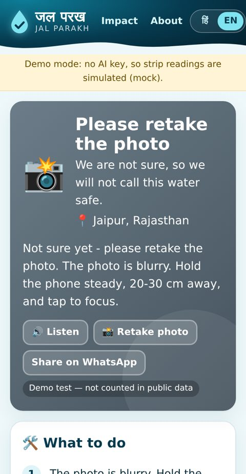
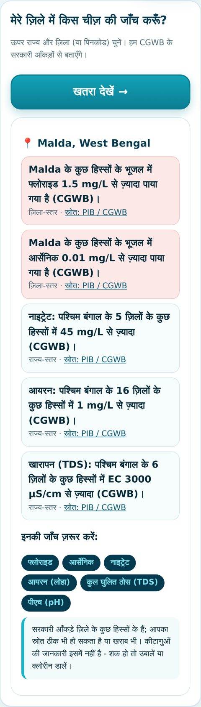
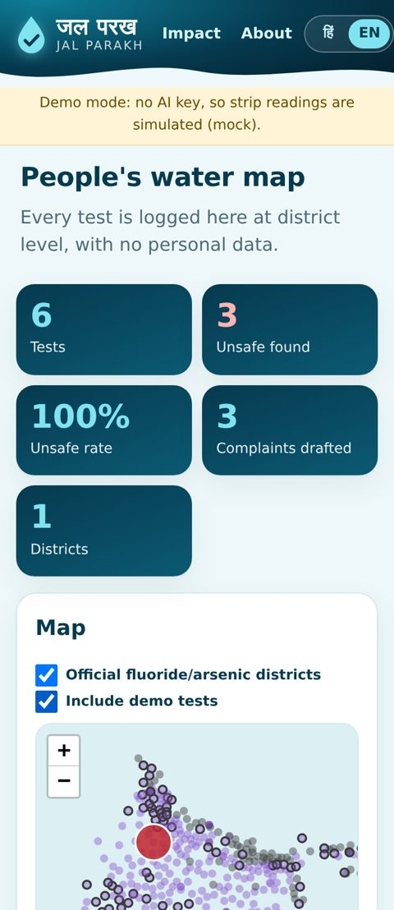
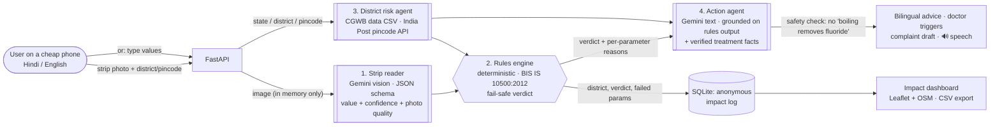
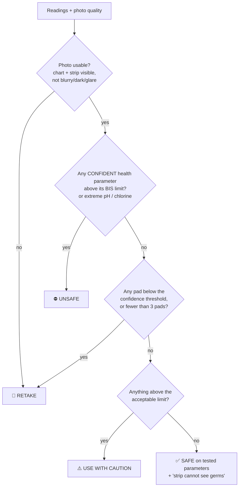

<p align="center"></p>

<h1 align="center">जल परख · Jal Parakh</h1>
<p align="center"><b>Is my water safe to drink? An open-source agentic-AI water-safety assistant for India.</b><br>
Photograph a ₹-cheap test strip → AI reads it → fixed rules check it against <b>BIS IS 10500:2012</b> → official <b>CGWB</b> data says what else to test for in your district → you get the cheapest fix that actually works, in <b>Hindi and English</b>, plus a complaint draft for PHED / Jal Jeevan Mission.</p>

<p align="center">
<a href="#quick-start-mock-mode-no-keys-about-1-minute"><b>▶ Run it in 1 minute</b></a> ·
<a href="#deploy-free-on-render"><b>Deploy free on Render</b></a> ·
<a href="#how-the-agents-work"><b>How it works</b></a> ·
<a href="#screenshots"><b>Screenshots</b></a> ·
Entry for <b>Code for a Billion · Bharat Agentic-AI Hackathon 2026 — Clean Water</b> · MIT licensed · 100% free stack
</p>

> **Not a lab test.** Home strips are approximate and cannot detect bacteria. Jal Parakh never calls water safe on a low-confidence reading, but any worrying result should be confirmed at a district water testing laboratory. See the [disclaimer](#disclaimer).

---

## The problem

| | |
|---|---|
| **~2 lakh deaths a year** | About two lakh people in India die every year due to inadequate access to safe water, and **600 million** face high-to-extreme water stress. — NITI Aayog, *Composite Water Management Index* (2018), [PDF](https://www.niti.gov.in/sites/default/files/2023-03/CompositeWaterManagementIndex-CWMI.pdf) |
| **Fluoride in 370 districts, arsenic in 152** | Fluoride above the BIS limit has been found in pockets of **370 districts across 23 States** and arsenic in **152 districts across 21 States**. — Ministry of Jal Shakti, [PIB, 24 Mar 2022](https://www.pib.gov.in/PressReleasePage.aspx?PRID=1809264) |
| **1 in 5 groundwater samples fail on nitrate** | Of 15,259 CGWB samples, **19.8%** exceeded the nitrate limit, **9.04%** fluoride and **3.1%** arsenic. — CGWB *Annual Ground Water Quality Report 2024*, [PIB, 10 Mar 2025](https://www.pib.gov.in/PressReleasePage.aspx?PRID=2109942) |

These contaminants are **invisible**: fluoride, arsenic and nitrate water looks, smells and tastes normal. The common household response, **boiling, kills germs but does not remove any of them** (it slightly concentrates them). Labs exist, but they are far, slow and unfamiliar, so most families never test, and the damage (dental and skeletal fluorosis, arsenic skin lesions and cancers, "blue baby" syndrome in infants) shows up years later.

Multi-parameter drinking-water strips cost a few rupees per test and are sold everywhere, but reading 9 tiny colour pads against a chart, then knowing what the numbers mean, is hard. That is the gap Jal Parakh closes.

## What Jal Parakh does

1. **📷 Reads the strip.** The user photographs a dipped strip next to the colour chart on its bottle. Gemini vision matches every pad (pH, total hardness, alkalinity, nitrate, nitrite, free chlorine, iron, fluoride, lead, plus copper/arsenic/TDS if the strip has them) and returns a value and a **confidence** for each.
2. **⚖️ Checks it with fixed rules, not AI.** A deterministic engine compares each value with the **BIS IS 10500:2012** acceptable / permissible limits (table in [`app/standards.py`](app/standards.py), source cited) and gives **Safe** / **Use with caution** / **Unsafe to drink**, with the reason per parameter.
3. **🛑 Fails safe.** Blurry photo, no colour chart, glare, a low-confidence pad, or too few pads → **"Please retake the photo"**. It never says "safe" or "caution" on a shaky read. A *confident* danger reading is never hidden behind a retake.
4. **🗺️ Knows your district.** Pick state + district (or type a pincode). Official CGWB data (bundled CSV) tells you whether fluoride or arsenic has been found in your district and how widespread nitrate, iron and salinity are in your state, so **even without a strip it tells you what to test for**.
5. **🛠️ Tells you what to do.** A Gemini action agent, grounded on the rules output and a verified treatment knowledge base, gives the **cheapest effective fix** (RO vs activated alumina vs community plant vs chlorine tablets, each only for what it really fixes), health warnings and **when to see a doctor**, in short, voice-friendly Hindi and English with a 🔊 *Listen* button (on-device speech, free).
6. **📝 Drafts a complaint.** For an unsafe or caution result, a ready-to-copy complaint in Hindi/English to the district PHED / Jal Jeevan Mission, with links to CPGRAMS and state helplines. **The app never sends anything.**
7. **📊 Proves impact.** Every test is logged **anonymously at district level** (no photo, name, phone, IP or exact location) to a public map and dashboard: tests run, unsafe found, unsafe rate by district, complaints drafted, with CSV export.

## Screenshots

Screenshots from mock mode with the synthetic demo strips (real-mode screenshots: _add after deployment_).

| Home (Hindi) | Unsafe result (Hindi) | Fail-safe retake | District risk | Impact map |
|---|---|---|---|---|
|  |  |  |  |  |

<!-- SCREENSHOT PLACEHOLDER: replace with real-phone photos of a real strip once deployed. -->

## How the agents work



**Agent responsibilities**

| Agent | Model | Can it change the verdict? | If it fails |
|---|---|---|---|
| Strip reader | Gemini vision (`responseSchema` JSON) | No, it only reports readings + confidence + photo quality | No verdict; the user is asked to retake or type values |
| Rules engine | none (Python) | **It is the verdict** | n/a (pure function, 40+ unit tests) |
| District risk agent | none (official data) | No, it adds "also test for X" gaps | Falls back to state-level data |
| Action agent | Gemini text, grounded | No, the prompt gets the verdict as fixed input | Deterministic bilingual template (also used in mock mode) |

**Verdict policy** (from [`app/standards.py`](app/standards.py)):



- **Health parameters** (fluoride, nitrate, nitrite, arsenic, lead, copper): between acceptable and permissible → caution; above permissible / "no relaxation" limit → unsafe.
- **Taste / scaling parameters** (pH, hardness, alkalinity, iron, TDS, chloride, sulphate, manganese, chlorine): above the limit → caution, with an explanation, unless extreme (pH < 5 or > 10, chlorine > 5 mg/L) → unsafe.
- Nitrite is not in IS 10500, so the WHO guideline (3 mg/L) is used and labelled "WHO".
- `CONFIDENCE_THRESHOLD` (default 0.6) is configurable.

**Async like ProofPay.** Gemini on a free tier can take a minute. Uploading returns at once (`status: reading`), a background thread runs the reader → rules → advice, and the result page polls. The verdict appears as soon as the rules engine runs; advice follows. If the server restarts mid-read the photo is gone (it is never stored), so the test is marked "please retake", never given a verdict.

**Honesty guard.** If the model's advice mentions boiling together with fluoride/arsenic/nitrate/lead without a negation ("boil to remove fluoride"), the whole model output is discarded and the verified template is shown instead (tested).

## Data

| Data | Source |
|---|---|
| **BIS IS 10500:2012** acceptable / permissible limits (with Amendment 1, 2015: iron 1.0 mg/L, no arsenic relaxation) | [BIS PDF](https://www.bis.gov.in/other/DrinWatIS10500.pdf) · [CPCB copy](https://cpcb.nic.in/wqm/BIS_Drinking_Water_Specification.pdf) · [Parliament extract, PIB](https://www.pib.gov.in/PressReleasePage.aspx?PRID=1843385) |
| **Fluoride & arsenic districts** → [`datasets/district_risks.csv`](datasets/district_risks.csv) (442 districts; 370 fluoride, 152 arsenic, matching the official totals) | CGWB via Ministry of Jal Shakti, [PIB 24 Mar 2022, Annexure-I](https://www.pib.gov.in/PressReleasePage.aspx?PRID=1809264) |
| **Nitrate / iron / salinity** by state → [`datasets/state_risks.csv`](datasets/state_risks.csv) | CGWB via Ministry of Jal Shakti, [PIB 29 Nov 2021, Annexure-I](https://www.pib.gov.in/PressReleasePage.aspx?PRID=1776171) |
| District map coordinates → [`datasets/district_centroids.csv`](datasets/district_centroids.csv) | [geohacker/india](https://github.com/geohacker/india) (MIT) + [Zenodo 12662782](https://doi.org/10.5281/zenodo.12662782) (CC BY 4.0) |
| Pincode → district | India Post public API `api.postalpincode.in` (free, no key), offline prefix fallback |

Cleaning is fully scripted in [`scripts/build_dataset.py`](scripts/build_dataset.py); details and limits in [`datasets/SOURCES.md`](datasets/SOURCES.md).

## Quick start (mock mode, no keys, about 1 minute)

```bash
git clone https://github.com/ridakalam52-design/jal-parakh && cd jal-parakh
python -m venv .venv && source .venv/bin/activate      # Windows: .venv\Scripts\activate
pip install -r requirements.txt
uvicorn app.main:app --reload
```

Open http://localhost:8000. A yellow bar says **demo mode** (no AI key).

**Try it**

1. Pick a state and district (for example *Rajasthan → Jaipur*), or type a pincode.
2. Under *"No strip? Try a synthetic demo photo"*, tap **🦷 High fluoride** → **Check water** → ⛔ **Unsafe**, with fixes, doctor triggers and a 📝 complaint draft. Toggle **हिं / EN** and tap **🔊 Listen**.
3. Try **🌫️ Blurry photo** → 📸 **Please retake** (fail-safe).
4. Open **Impact** → the map and counters. Demo tests are excluded unless you tick *Include demo tests*.

**Mock reader rules** (deterministic): the synthetic demo PNGs carry a `jalparakh_demo` tag that selects their readings; any other file name containing `blur` → blurry, `nochart` → no chart, `unsure` → low confidence, `fluor` → high fluoride, `nitrate`/`iron` → high nitrate + iron, anything else → a clean reading. Mock advice is the same verified template users get when Gemini is unavailable.

### Demo assets (synthetic)

`demo_assets/demo_safe.png`, `demo_high_fluoride.png`, `demo_high_nitrate_iron.png` and `demo_blurry.png` are **synthetic images drawn with Pillow** by [`scripts/make_demo_strips.py`](scripts/make_demo_strips.py). They are **not photos of real water**, are stamped "SYNTHETIC DEMO IMAGE", and any test made with them is flagged `is_demo` and **excluded from the public impact numbers**, even when real Gemini is on.

### Tests

```bash
pytest -q
```

96 tests: rules engine and every BIS limit, the fail-safe verdict policy, district data (including the 370/152 totals), advice honesty, the complaint draft, the full API flow in mock mode, the async path with a fake slow model (reader failure → no verdict, advice failure → template, unsafe model claims rejected, restart mid-read → retake), the Gemini REST client against a fake HTTP transport (fallback models on 404/429), impact log privacy, CSV export/import and rate limiting.

## Real mode (free Gemini key)

1. Go to https://aistudio.google.com/apikey → **Create API key** (free tier).
2. `cp .env.example .env` and set `GEMINI_API_KEY`.
3. Restart. The footer shows `AI: gemini:gemini-3.1-flash-lite`.

| Env var | Default | What it does |
|---|---|---|
| `GEMINI_API_KEY` | _(empty → mock)_ | Free key from Google AI Studio. **Secret.** |
| `GEMINI_MODEL` | `gemini-3.1-flash-lite` | Primary model (vision + text) |
| `GEMINI_FALLBACK_MODEL` | _(empty)_ | Comma-separated models tried in order on 404/429/5xx, e.g. `gemini-flash-lite-latest,gemini-2.5-flash-lite,gemini-3.5-flash` |
| `GEMINI_TIMEOUT` / `GEMINI_TOTAL_BUDGET` | `60` / `150` s | Per call / total retry budget (AI runs in the background) |
| `JALPARAKH_MODE` | `auto` | `mock` forces mock mode |
| `CONFIDENCE_THRESHOLD` | `0.6` | Below this a pad is "uncertain" → retake |
| `PINCODE_LOOKUP` | `on` | `off` = offline prefix table only |
| `ADMIN_TOKEN` | _(empty → disabled)_ | Protects `POST /api/admin/import`. **Secret.** |
| `RATE_LIMIT` | `30` | Tests per client per 10 min (in memory) |
| `DATABASE_PATH` | `./data/jalparakh.db` | SQLite file |
| `MAX_PHOTO_MB` | `8` | Upload limit |

On startup the server logs which "flash" models your key can use (never the key).

## Deploy free on Render

[](https://render.com/deploy?repo=https://github.com/ridakalam52-design/jal-parakh)

1. Click the button (or Render → **New → Blueprint** → pick this repo). [`render.yaml`](render.yaml) sets up a **free** web service.
2. In **Environment**, add `GEMINI_API_KEY` (and optionally `ADMIN_TOKEN`). Without a key it runs in mock mode.
3. Health check: `/healthz`.

**Free-tier persistence.** Render's free disk is temporary, so the impact log resets when the service redeploys or sleeps. To keep deployment data: download `/api/impact.csv` regularly (it is also your evidence for judges), and after a redeploy restore it with

```bash
curl -X POST https://<your-app>.onrender.com/api/admin/import \
  -H "x-admin-token: $ADMIN_TOKEN" --data-binary @jal-parakh-reports.csv
```

## Architecture & code map

| Path | What it does |
|---|---|
| `app/main.py` | FastAPI app: pages (`/`, `/t/{id}`, `/impact`, `/about`) and the JSON API |
| `app/services.py` | Pipeline orchestration: reader → rules → district risk → action agent, async jobs, impact stats, CSV |
| `app/standards.py` | **Rules engine** and the BIS IS 10500:2012 limits table (cited) |
| `app/ai.py` | `GeminiAgent` (REST `generateContent`, JSON schema, inline image, fallback models), `MockAgent`, output normalisation and the honesty guard |
| `app/advice.py` | Verified treatment knowledge base (EN/HI), doctor triggers, complaint draft templates |
| `app/risk.py` | District risk agent, name matching (aliases + fuzzy), pincode lookup, map coordinates |
| `app/db.py` | SQLite: `tests` (per-user result) and `reports` (anonymous impact log) |
| `app/templates`, `app/static` | Mobile-first UI in vanilla JS, Hindi-first i18n, Leaflet (vendored) + OSM tiles |
| `datasets/` | Cleaned official CSVs + `SOURCES.md` |
| `scripts/` | `build_dataset.py` (data cleaning), `make_demo_strips.py` (synthetic demo images) |
| `tests/` | pytest suite (mock mode, fake model, fake HTTP transport) |

### API

| Method | Path | |
|---|---|---|
| POST | `/api/tests` (multipart `photo`, `state`, `district`, `pincode`, `lang`) | start a strip test → `{id, status, url}` |
| POST | `/api/manual` `{values:{fluoride:2.1,…}, state, district, pincode}` | test from typed values |
| GET | `/api/tests/{id}` | poll a test (verdict, per-parameter results, advice) |
| POST | `/api/tests/{id}/complaint?lang=hi` | complaint draft (Hindi + English); never sent |
| GET | `/api/risk?state=&district=&pincode=` | district risk + "test for" list |
| GET | `/api/places`, `/api/places?state=` | states (EN/HI) and district names |
| GET | `/api/limits` | the BIS limits table |
| GET | `/api/impact[?include_demo=true]`, `/api/impact.csv` | dashboard data and CSV export |
| GET | `/api/risk-layer` | official fluoride/arsenic districts with coordinates (map layer) |
| POST | `/api/admin/import` (header `x-admin-token`) | restore the impact log from CSV |
| GET | `/healthz` | mode check |

## Privacy

- Photos are processed **in memory** and **never written to disk**.
- The public log keeps only: day, state, district, source (strip/manual), verdict, which parameters failed, whether a complaint was drafted, demo flag, model name.
- No names, phone numbers, IP addresses or exact locations are stored. Rate limiting keeps client IPs in memory for 10 minutes only.

## Built for cheap phones

Vanilla JS and CSS, no framework, no web fonts (system Devanagari fonts), big touch targets, camera capture straight from the file input, on-device text-to-speech, and Leaflet bundled locally (only map tiles come from OpenStreetMap, and only on the Impact page).

## Disclaimer

**Jal Parakh is an awareness and triage tool, not a laboratory test and not medical advice.** Home test strips are approximate, can be misread (by people and by AI) and **cannot detect bacteria or viruses**. A "safe" result means only that the tested parameters looked within BIS limits. Confirm any unsafe or worrying result at your district water testing laboratory (many are open to the public at a nominal fee; see the [JJM Citizen Corner](https://ejalshakti.gov.in/jjmreport/JJMIndia.aspx)) and consult a doctor for health concerns. Official contamination data covers only parts of each district.

**जल परख प्रयोगशाला जाँच या डॉक्टरी सलाह नहीं है।** घरेलू स्ट्रिप मोटा अंदाज़ा देती है और कीटाणु नहीं पकड़ती। गंभीर नतीजे की पुष्टि ज़िला जल परीक्षण प्रयोगशाला से कराएँ।

## AI tools used

- **Google Gemini API** (free tier) inside the product: the strip-reading vision agent and the grounded action agent.
- **AI coding assistant**: an AI agent helped write the code, tests and docs; the demo images are drawn programmatically (no generative image model). *(Edit this line to match the tools you actually used.)*

## What's next

- Field pilot with a school / SHG / Gram Panchayat to collect real deployment data for the impact map.
- On-device colour calibration (white-balance from the chart's white swatch) and a classical CV cross-check of the AI reading.
- District-level nitrate / uranium lists from the CGWB 2024 report annexures.
- WhatsApp bot front-end and offline-first PWA; more Indian languages.
- Persistent free database (or a scheduled CSV backup) so the impact log survives free-tier redeploys.

## License

[MIT](LICENSE) © 2026 Rida Kalam
