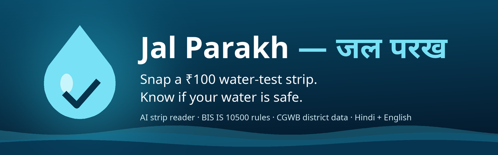
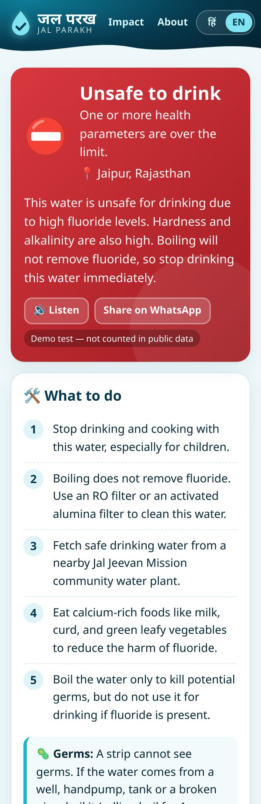
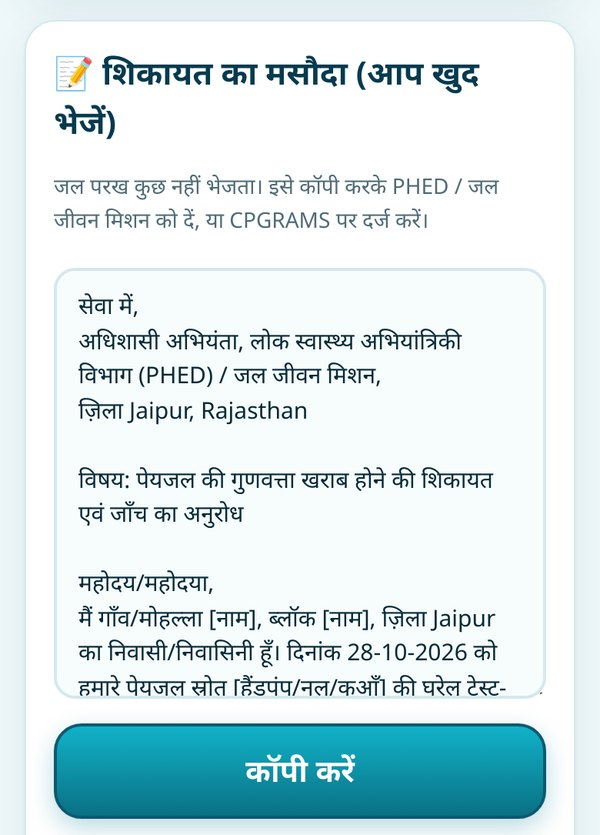
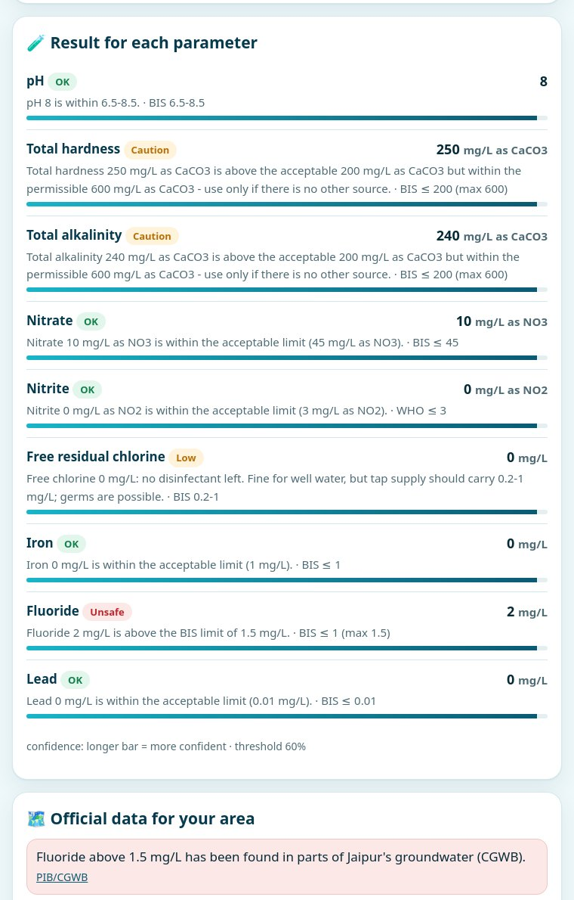
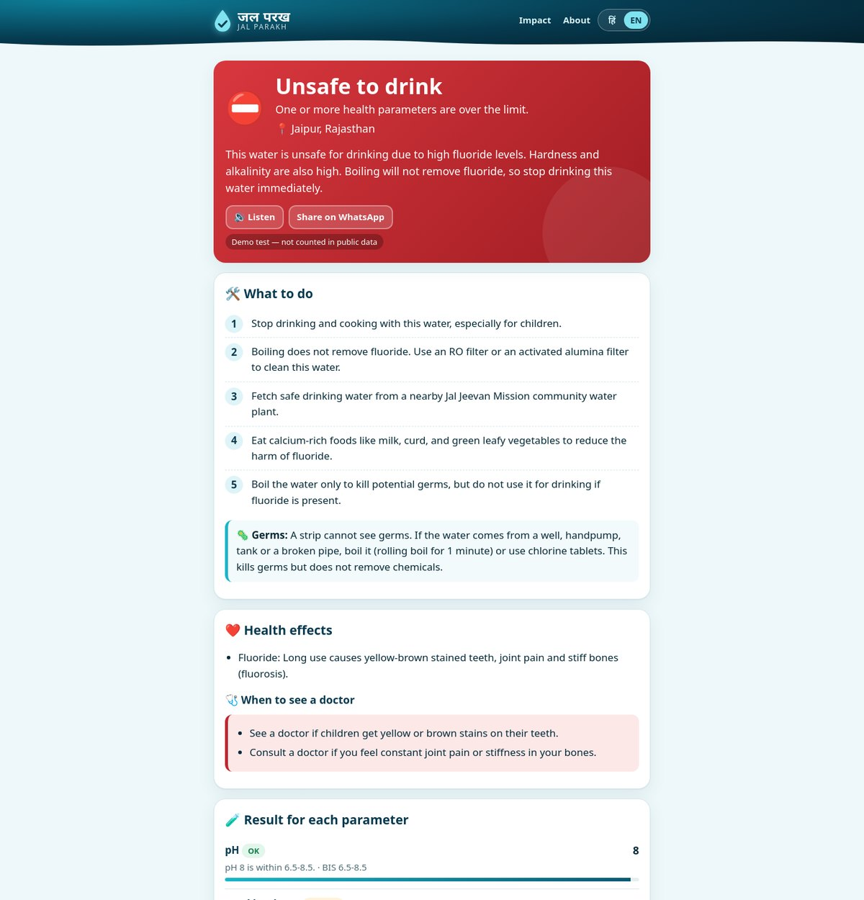
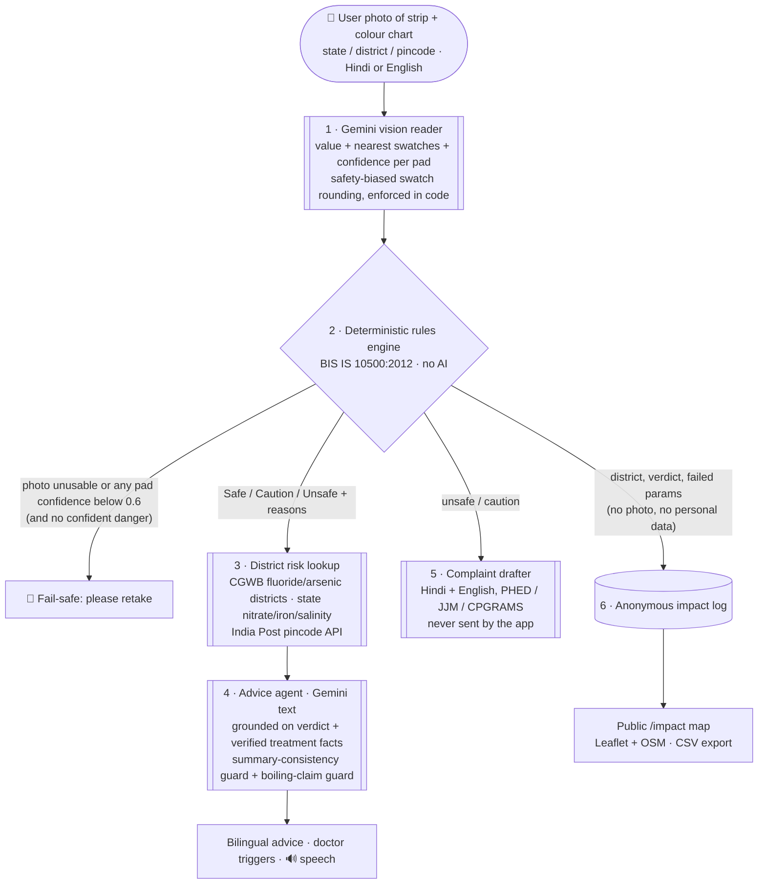
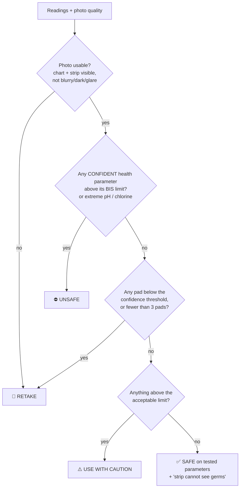

<p align="center"></p>

<p align="center">
<a href="https://jal-parakh.onrender.com"><b>▶ Live demo: jal-parakh.onrender.com</b></a> ·
<a href="#screenshots">Screenshots</a> ·
<a href="#how-it-works">How it works</a> ·
<a href="#accuracy--limitations">Accuracy &amp; limitations</a> ·
<a href="#built-with-agentfoundry">Built with AgentFoundry</a>
</p>

<p align="center">Demo video: https://youtu.be/kLYx4bpgjcU</p>

**Jal Parakh (जल परख, "water check")** is an open-source agentic-AI water-safety assistant for India. Photograph a cheap multi-parameter test strip next to its colour chart → Gemini vision reads the pads → a fixed rules engine checks them against **BIS IS 10500:2012** → official **CGWB** data says what else to test for in your district → you get the cheapest fix that actually works, in **Hindi and English**, plus a complaint draft for PHED / Jal Jeevan Mission.

Entry for **Code for a Billion · Bharat Agentic-AI Hackathon 2026 — Clean Water**. MIT licensed, 100% free stack.

> The live demo runs on Render's free tier: the first visit after a quiet spell can take ~30–60 s to wake up, and a strip reading can take up to a minute. Tap one of the synthetic demo strips on the home page to try it without a real strip.

> **Not a lab test.** Home strips are approximate and cannot detect bacteria. Jal Parakh never calls water safe on a low-confidence reading, but any worrying result should be confirmed at a district water testing laboratory. See the [disclaimer](#disclaimer).

## Screenshots

Taken from the live app (gemini-3.5-flash) on 28 Oct 2026 with the synthetic demo strip `demo_assets/demo_high_fluoride.png`, location Rajasthan → Jaipur.

| Home (Hindi) | Unsafe result (Hindi) | Unsafe result (English) | Complaint draft |
|---|---|---|---|
|  |  |  |  |

| Fail-safe retake (blurry photo) | District risk (CGWB data) | Per-parameter check (BIS) |
|---|---|---|
|  |  |  |

**Desktop: result page and the public impact map**

 

The impact map shows the official fluoride (purple) and arsenic (dark) districts as a background layer; the counters read 0 because demo tests are excluded from public numbers and no real tests have been logged yet.

## The problem

| | |
|---|---|
| **~2 lakh deaths a year** | About two lakh people in India die every year due to inadequate access to safe water, and **600 million** face high-to-extreme water stress. — NITI Aayog, *Composite Water Management Index* (2018), [PDF](https://www.niti.gov.in/sites/default/files/2023-03/CompositeWaterManagementIndex-CWMI.pdf) |
| **Fluoride in 370 districts, arsenic in 152** | Fluoride above permissible limits has been found in parts of **370 districts across 23 States** and arsenic in parts of **152 districts across 21 States**. — CGWB data via Ministry of Jal Shakti, [PIB, 24 Mar 2022 (PRID 1809264)](https://www.pib.gov.in/PressReleasePage.aspx?PRID=1809264) |
| **Nitrate: 1 in 5 groundwater samples** | Of 15,259 CGWB monitoring samples, **19.8%** exceeded the nitrate limit (45 mg/L), in parts of **443 districts in 23 States/UTs**; fluoride was high in 9.04% and arsenic in 3.1%. — CGWB *Annual Ground Water Quality Report 2024*, [PIB, 10 Mar 2025 (PRID 2109942)](https://www.pib.gov.in/PressReleasePage.aspx?PRID=2109942) |

These contaminants are **invisible**: water with fluoride, arsenic or nitrate looks, smells and tastes normal. The common household response, **boiling, kills germs but removes none of them** (it slightly concentrates them). Labs exist, but they are far, slow and unfamiliar, so most families never test, and the damage (dental and skeletal fluorosis, arsenic skin lesions and cancers, "blue baby" syndrome in infants) shows up years later.

Multi-parameter drinking-water strips cost around ₹100 for a pack and are easy to buy, but reading 9 tiny colour pads against a chart, then knowing what the numbers mean, is hard. That is the gap Jal Parakh closes.

## What Jal Parakh does

1. **📷 Reads the strip.** The user photographs a dipped strip next to the colour chart on its bottle. Gemini vision matches every pad (pH, total hardness, alkalinity, nitrate, nitrite, free chlorine, iron, fluoride, lead, plus copper/arsenic/TDS if the strip has them) and returns a value, the two nearest swatches and a **confidence** for each.
2. **⚖️ Checks it with fixed rules, not AI.** A deterministic engine compares each value with the **BIS IS 10500:2012** acceptable / permissible limits (table in [`app/standards.py`](app/standards.py), source cited) and gives **Safe** / **Use with caution** / **Unsafe to drink**, with the reason per parameter.
3. **🛑 Fails safe.** Blurry photo, no colour chart, glare, a pad below 0.6 confidence, or too few pads → **"Please retake the photo"**. It never says "safe" or "caution" on a shaky read. A *confident* danger reading is never hidden behind a retake.
4. **🗺️ Knows your district.** Pick state + district (or type a pincode). Official CGWB data (bundled CSV) tells you whether fluoride or arsenic has been found in your district and how widespread nitrate, iron and salinity are in your state, so **even without a strip it tells you what to test for**.
5. **🛠️ Tells you what to do.** A Gemini advice agent, grounded on the rules output and a verified treatment knowledge base, gives the **cheapest effective fix** (RO vs activated alumina vs community plant vs chlorine tablets, each only for what it really fixes), health warnings and **when to see a doctor**, in short, voice-friendly Hindi and English with a 🔊 *Listen* button (on-device speech, free).
6. **📝 Drafts a complaint.** For an unsafe or caution result, a ready-to-copy complaint in Hindi/English to the district PHED / Jal Jeevan Mission, with links to CPGRAMS and the DDWS grievance portal. **The app never sends anything.**
7. **📊 Shows impact.** Every real test is logged **anonymously at district level** (no photo, name, phone, IP or exact location) to a public map and dashboard at [`/impact`](https://jal-parakh.onrender.com/impact): tests run, unsafe found, unsafe rate by district, complaints drafted, with CSV export.

## How it works



- **Safety-biased swatch rounding.** The reader reports the two nearest chart swatches for every pad. If a pad sits between two swatches, code (not the model) takes the **riskier** value and caps confidence, so an in-between reading can never make water look cleaner than it is ([`safety_round` in `app/ai.py`](app/ai.py)).
- **The rules engine is the verdict.** The AI only reports readings; it cannot change Safe / Caution / Unsafe.
- **Fail-safe retake.** If the photo is unusable or any pad is below the 0.6 confidence threshold, the user is asked to retake. A confident danger reading still shows as Unsafe.
- **Summary-consistency guard.** If the verdict is not "safe" but the model's summary calls the water safe, the summary is replaced with the verified template. If the advice claims boiling removes fluoride/arsenic/nitrate/lead, all model text is discarded.

**Agent responsibilities**

| Agent | Model | Can it change the verdict? | If it fails |
|---|---|---|---|
| Strip reader | Gemini vision (`responseSchema` JSON) | No, it only reports readings + confidence + photo quality | No verdict; the user is asked to retake or type values |
| Rules engine | none (Python) | **It is the verdict** | n/a (pure function, unit tested) |
| District risk lookup | none (official data) | No, it adds "also test for X" | Falls back to state-level data |
| Advice agent | Gemini text, grounded | No, it gets the verdict as fixed input | Deterministic bilingual template (also used in mock mode) |
| Complaint drafter | none (template) | No | n/a |

**Verdict policy** (from [`app/standards.py`](app/standards.py)):



- **Health parameters** (fluoride, nitrate, nitrite, arsenic, lead, copper): between acceptable and permissible → caution; above permissible / "no relaxation" limit → unsafe.
- **Taste / scaling parameters** (pH, hardness, alkalinity, iron, TDS, chloride, sulphate, manganese, chlorine): above the limit → caution, with an explanation, unless extreme (pH < 5 or > 10, chlorine > 5 mg/L) → unsafe.
- Nitrite is not in IS 10500, so the WHO guideline (3 mg/L) is used and labelled "WHO".
- `CONFIDENCE_THRESHOLD` (default 0.6) is configurable.

**Async by design.** Gemini on a free tier can take a minute. Uploading returns at once (`status: reading`), a background thread runs the reader → rules → advice, and the result page polls. The verdict appears as soon as the rules engine runs; advice follows. If the server restarts mid-read the photo is gone (it is never stored), so the test is marked "please retake", never given a verdict.

**Honesty guard.** If the model's advice mentions boiling together with fluoride/arsenic/nitrate/lead without a negation ("boil to remove fluoride"), the whole model output is discarded and the verified template is shown instead (tested).

### Data sources

| Data | Source |
|---|---|
| **BIS IS 10500:2012** acceptable / permissible limits (with Amendment 1, 2015: iron 1.0 mg/L, no arsenic relaxation) | [BIS PDF](https://www.bis.gov.in/other/DrinWatIS10500.pdf) · [CPCB copy](https://cpcb.nic.in/wqm/BIS_Drinking_Water_Specification.pdf) · [Parliament extract, PIB](https://www.pib.gov.in/PressReleasePage.aspx?PRID=1843385) |
| **Fluoride & arsenic districts** → [`datasets/district_risks.csv`](datasets/district_risks.csv) (442 districts; 370 fluoride, 152 arsenic, matching the official totals) | CGWB via Ministry of Jal Shakti, [PIB 24 Mar 2022, Annexure-I](https://www.pib.gov.in/PressReleasePage.aspx?PRID=1809264) |
| **Nitrate / iron / salinity** by state → [`datasets/state_risks.csv`](datasets/state_risks.csv) | CGWB via Ministry of Jal Shakti, [PIB 29 Nov 2021, Annexure-I](https://www.pib.gov.in/PressReleasePage.aspx?PRID=1776171) |
| District map coordinates → [`datasets/district_centroids.csv`](datasets/district_centroids.csv) | [geohacker/india](https://github.com/geohacker/india) (MIT) + [Zenodo 12662782](https://doi.org/10.5281/zenodo.12662782) (CC BY 4.0) |
| Pincode → district | India Post public API `api.postalpincode.in` (free, no key), offline prefix fallback |

Cleaning is fully scripted in [`scripts/build_dataset.py`](scripts/build_dataset.py); details and limits in [`datasets/SOURCES.md`](datasets/SOURCES.md).


## Built with AgentFoundry

Part of this project was built in the **AgentFoundry desktop IDE** (v0.1.80) on **28 October 2026**. AgentFoundry's bundled coding agent **SMART-Code** was given the task of adding a `GET /api/strip-chart` endpoint: it read the codebase, planned the change and wrote the first version of the endpoint, a new shared colour-chart module (`app/strip_chart.py`), the refactor of `scripts/make_demo_strips.py` to use it, and the tests in `tests/test_strip_chart.py`. A second review-feedback turn (full source citations, `{value, hex}` swatch objects, stronger tests) was also applied by SMART-Code; the final review and two simplifications were done by hand, the demo images were regenerated and confirmed byte-for-byte unchanged, and the suite was run in AgentFoundry's terminal (`100 passed` at the time).

Full write-up and screenshots: [`docs/agentfoundry/README.md`](docs/agentfoundry/README.md).

## API

| Method | Path | |
|---|---|---|
| POST | `/api/tests` (multipart `photo`, `state`, `district`, `pincode`, `lang`, `practice`) | start a strip test → `{id, status, url}`; poll for the result |
| POST | `/api/manual` `{values:{fluoride:2.1,…}, state, district, pincode}` | test from typed values |
| GET | `/api/tests/{id}` | poll a test (verdict, per-parameter results, advice) |
| POST | `/api/tests/{id}/complaint?lang=hi` | complaint draft (Hindi + English); never sent |
| GET | `/api/risk?state=&district=&pincode=` | district risk + "test for" list |
| GET | `/api/places`, `/api/places?state=` | states (EN/HI) and district names |
| GET | `/api/limits` | the BIS limits table |
| GET | `/api/strip-chart` | every supported strip parameter with BIS/WHO limits, sources and demo colour-chart swatches (built with AgentFoundry) |
| GET | `/api/impact[?include_demo=true]`, `/api/impact.csv` | dashboard data and CSV export |
| GET | `/api/risk-layer` | official fluoride/arsenic districts with coordinates (map layer) |
| POST | `/api/admin/import` (header `x-admin-token`) | restore the impact log from CSV |
| GET | `/healthz` | mode and model check |

Pages: `/` (home), `/t/{id}` (result), `/impact` (public map), `/about`.

## Accuracy & limitations

Live test on **28 Oct 2026** against the deployed app (**gemini-3.5-flash**) with the **synthetic** demo strips in `demo_assets/`:

| Strip | True values | Read by the model | Verdict |
|---|---|---|---|
| High nitrate / iron | nitrate 100, nitrite 1, iron 3, hardness 120 | nitrate 50, nitrite 0.5, iron 1.0, hardness 120 | **UNSAFE** ✅ correct |
| High fluoride | fluoride 2.0, hardness 250 | fluoride 4.0, hardness 250 | **UNSAFE** ✅ correct |
| Safe | fluoride 0.5, hardness 120 | fluoride 0, hardness 120 | **SAFE** ✅ correct |

(Values in mg/L; hardness as CaCO₃.)

- **Verdicts were 3/3 correct, but individual pads can still be off by a swatch** (nitrate and iron read low, fluoride read high, fluoride 0.5 read as 0). Readings also vary run to run: a repeat run on the same fluoride strip while taking the screenshots read fluoride 2.0, exactly right.
- **Found through testing:** before the safety fix, the earlier default model (gemini flash-lite) read the high-nitrate strip low enough to call it **safe**. That led to safety-biased swatch rounding enforced in code, a stricter reader prompt, and the stronger default model.
- **Real phone photos of commercial strips are not validated yet.** All numbers above are synthetic images drawn by `scripts/make_demo_strips.py`. Lighting, camera white balance, strip brand and timing will all add error.
- A strip cannot detect bacteria or viruses, and covers only the parameters printed on it. A "safe" result means only that the tested parameters looked within BIS limits.
- Official contamination data covers parts of each district, not every village or well.
- The free Render instance has an ephemeral disk, so the impact log resets on redeploy unless exported and re-imported.

## Roadmap

- **Field pilot** with an NGO, self-help group or school in **Kanpur** to collect real phone photos of real strips, compare with lab results, and put real data on the impact map.
- **WhatsApp bot** front-end (send a photo, get the verdict and advice back).
- **Offline mode** (installable PWA, rules engine and district data on the phone).
- **More strip brands**: per-brand chart profiles and validation.
- **Persistent database** so the impact log survives free-tier redeploys.
- **Hindi native-speaker review** of all advice and complaint text; then more Indian languages.
- On-device colour calibration from the chart's white swatch and a classical CV cross-check of the AI reading.

## Setup

```bash
git clone https://github.com/ridakalam52-design/jal-parakh && cd jal-parakh
python -m venv .venv && source .venv/bin/activate      # Windows: .venv\Scripts\activate
pip install -r requirements.txt
uvicorn app.main:app --reload
```

Open http://localhost:8000. Without a Gemini key it runs in **mock mode** (a yellow bar says *demo mode*): the synthetic demo strips give deterministic readings and advice comes from the verified template.

**Try it:** pick *Rajasthan → Jaipur*, tap **🦷 High fluoride** → **Check water** → ⛔ **Unsafe** with fixes, doctor triggers and a 📝 complaint draft; toggle **हिं / EN**; try **🌫️ Blurry photo** → 📸 **Please retake**; open **Impact** for the map.

### Real mode (free Gemini key)

1. Go to https://aistudio.google.com/apikey → **Create API key** (free tier).
2. `cp .env.example .env` and set `GEMINI_API_KEY`.
3. Restart. The footer shows `AI: gemini:gemini-3.5-flash`.

| Env var | Default | What it does |
|---|---|---|
| `GEMINI_API_KEY` | _(empty → mock)_ | Free key from Google AI Studio. **Secret.** |
| `GEMINI_MODEL` | `gemini-3.5-flash` | Primary model (vision + text) |
| `GEMINI_FALLBACK_MODEL` | `gemini-2.5-flash,gemini-3.1-flash-lite` | Comma-separated models tried in order on 404/429/5xx |
| `GEMINI_TIMEOUT` / `GEMINI_TOTAL_BUDGET` | `60` / `150` s | Per call / total retry budget (AI runs in the background) |
| `JALPARAKH_MODE` | `auto` | `mock` forces mock mode |
| `CONFIDENCE_THRESHOLD` | `0.6` | Below this a pad is "uncertain" → retake |
| `PINCODE_LOOKUP` | `on` | `off` = offline prefix table only |
| `ADMIN_TOKEN` | _(empty → disabled)_ | Protects `POST /api/admin/import`. **Secret.** |
| `RATE_LIMIT` | `30` | Tests per client per 10 min (in memory) |
| `DATABASE_PATH` | `./data/jalparakh.db` | SQLite file |
| `MAX_PHOTO_MB` | `8` | Upload limit |

On startup the server logs which "flash" models your key can use (never the key).


### Tests

```bash
pytest -q
```

The suite covers the rules engine and every BIS limit, the fail-safe verdict policy, safety-biased rounding, district data (including the official 370/152 totals and district-name aliases), advice honesty guards, the complaint draft, the full API flow in mock mode, the async path with a fake slow model, the Gemini REST client against a fake HTTP transport (fallback models on 404/429), `/api/strip-chart`, impact-log privacy, CSV export/import and rate limiting.

### Demo assets (synthetic)

`demo_assets/demo_safe.png`, `demo_high_fluoride.png`, `demo_high_nitrate_iron.png` and `demo_blurry.png` are **synthetic images drawn with Pillow** by [`scripts/make_demo_strips.py`](scripts/make_demo_strips.py). They are **not photos of real water**, are stamped "SYNTHETIC DEMO IMAGE", and any test made with them is flagged as a demo and **excluded from the public impact numbers**, even with real Gemini on.

## Deploy (Render free tier)

[](https://render.com/deploy?repo=https://github.com/ridakalam52-design/jal-parakh)

1. Click the button (or Render → **New → Blueprint** → pick this repo). [`render.yaml`](render.yaml) sets up a **free** web service.
2. In **Environment**, add `GEMINI_API_KEY` (and optionally `ADMIN_TOKEN`). Without a key it runs in mock mode.
3. Health check: `/healthz`.

**Free-tier persistence.** Render's free disk is temporary, so the impact log resets when the service redeploys. Download `/api/impact.csv` regularly and restore it after a redeploy with

```bash
curl -X POST https://<your-app>.onrender.com/api/admin/import \
  -H "x-admin-token: $ADMIN_TOKEN" --data-binary @jal-parakh-reports.csv
```

### Code map

| Path | What it does |
|---|---|
| `app/main.py` | FastAPI app: pages (`/`, `/t/{id}`, `/impact`, `/about`) and the JSON API |
| `app/services.py` | Pipeline orchestration: reader → rules → district risk → action agent, async jobs, impact stats, CSV |
| `app/standards.py` | **Rules engine** and the BIS IS 10500:2012 limits table (cited) |
| `app/ai.py` | `GeminiAgent` (REST `generateContent`, JSON schema, inline image, fallback models), `MockAgent`, output normalisation and the honesty guard |
| `app/strip_chart.py` | Colour-chart ramps for the synthetic demo strips, served by `/api/strip-chart` (built with AgentFoundry SMART-Code) |
| `app/advice.py` | Verified treatment knowledge base (EN/HI), doctor triggers, complaint draft templates |
| `app/risk.py` | District risk agent, name matching (aliases + fuzzy), pincode lookup, map coordinates |
| `app/db.py` | SQLite: `tests` (per-user result) and `reports` (anonymous impact log) |
| `app/templates`, `app/static` | Mobile-first UI in vanilla JS, Hindi-first i18n, Leaflet (vendored) + OSM tiles |
| `datasets/` | Cleaned official CSVs + `SOURCES.md` |
| `scripts/` | `build_dataset.py` (data cleaning), `make_demo_strips.py` (synthetic demo images), `make_banner.py` (README banner) |
| `tests/` | pytest suite (mock mode, fake model, fake HTTP transport) |

## Privacy

- Photos are processed **in memory** and **never written to disk**.
- The public log keeps only: day, state, district, source (strip/manual), verdict, which parameters failed, whether a complaint was drafted, demo flag, model name.
- No names, phone numbers, IP addresses or exact locations are stored. Rate limiting keeps client IPs in memory for 10 minutes only.

## Built for cheap phones

Vanilla JS and CSS, no framework, no web fonts (system Devanagari fonts), big touch targets, camera capture straight from the file input, on-device text-to-speech, and Leaflet bundled locally (only map tiles come from OpenStreetMap, and only on the Impact page).

## Disclaimer

**Jal Parakh is an awareness and triage tool, not a laboratory test and not medical advice.** Home test strips are approximate, can be misread (by people and by AI) and **cannot detect bacteria or viruses**. A "safe" result means only that the tested parameters looked within BIS limits. Confirm any unsafe or worrying result at your district water testing laboratory (many are open to the public at a nominal fee; see the [JJM Citizen Corner](https://ejalshakti.gov.in/jjmreport/JJMIndia.aspx)) and consult a doctor for health concerns. Official contamination data covers only parts of each district.

**जल परख प्रयोगशाला जाँच या डॉक्टरी सलाह नहीं है।** घरेलू स्ट्रिप मोटा अंदाज़ा देती है और कीटाणु नहीं पकड़ती। गंभीर नतीजे की पुष्टि ज़िला जल परीक्षण प्रयोगशाला से कराएँ।

## AI used

- **At runtime:** the Google **Gemini API** (default `gemini-3.5-flash`, free tier) powers the strip-reading vision agent and the grounded advice agent. The verdict itself is computed by deterministic code.
- **In development:** the project was developed with AI coding assistance, including **AgentFoundry SMART-Code** (see [Built with AgentFoundry](#built-with-agentfoundry)). The demo images and the banner are drawn programmatically with Pillow; no generative image model was used.

## License

[MIT](LICENSE) © 2026 Rida Kalam
